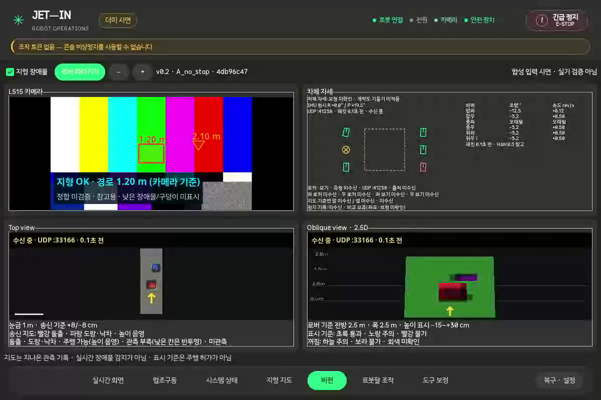

# 비전 탭 7단계 — 실기 연결 대기 / Draft PR 준비

**7단계는 미완료다.** 실기 접속이 불가능해 Gateway+L515 600초 인수는 수행하지 못했다.
PR·합성 동작 영상·실기 절차를 준비하고 미검증을 명시한다.
브랜치 `agent/vision-tab-20261023`, PR base `feat/l515-terrain-map`.
Draft PR: [#20](https://github.com/lightminn/power-train-sw/pull/20). 실제 검증 전이므로 Draft 상태를 유지한다.

## 연결 확인

- GitHub #19는 `feat/l515-terrain-map`에 `a40ea170f871b86d4772763d55d3158ffcaabb29`로 병합돼 있다.
- 노트북 주소는 `172.20.10.3/28`, 현재 기본 경로는 `172.20.10.1`이다.
- 로컬 설정의 대상은 `jetson-orin.local`; 관례 alias `jetson`과 함께 이름 해석에 실패했다.
- 실제 SSH 사용자/IP·네트워크/센서 연결 상태를 요청했으나 아직 전달받지 못했다.
- 원격 checkout·미커밋 상태·Gateway 소유권·컨테이너/ROS 기동 상태·실제 송신 목적지는 미확인이다.
  로봇에 접속/배포하거나 서비스를 재시작하지 않았다.

[실기 실행·측정 절차](2026-10-24-vision-tab-field-runbook.md)를 준비했다.
CPU/RSS/전원/클럭/온도 수집기는 대상 PID만 읽으며 카메라 연결을 추가하지 않는다.
프로세스 종료/전원 분리는 미완료로 기록하고, 미관측 값을 0으로 만들지 않는다.
이 도구의 complete는 CPU 수집 완료만 뜻하며, 실기/FPS/표시 정지 통과가 아니다.

## 동작 영상 — 합성 입력

[WebM 시연 영상](2026-10-24-vision-tab-step7-evidence/vision-synthetic-demo.webm)

- 노트북 Graphite GUI, L515 테스트 영상+장애물 polygon, 전방의 돌출/함몰이 있는 지도 3 tile,
  raw 자세·실제 피드백 형식의 바퀴 값, 선택 encoder fixture를 사용한다.
- UI에 **합성 입력 시연 · 실기 검증 아님**을 표시한다.
- 미수신→LIVE→encoder fixture→오래된 측정→UDP 끊김→복구와 탭 왕복을 시연한다.
  실제 바닥 mask·보정 자세·AS5048B 실측으로 간주하지 않는다.
- Xvfb/X11에 띄운 **해당 콘솔 XID의 창만** 녹화한다. 사용자 데스크톱 전체를 녹화하지 않는다.
- WebM/VP8, 1200×800, 10 fps의 약 14초 영상이며, decoder로 실제 프레임을 읽어 네 영역과 합성 표시를 확인했다.

## 녹화 중 확인한 네이티브 충돌과 검사 도구 보강

초기 단독 녹화 명령은 Xvfb 안에서도 Wayland 환경을 상속했다.
당시 GDB는 합성 송/수신을 같은 GTK 프로세스에서 실행할 때 SRT `epoll_add_ssock`의
C++ unwind 경로에서 SIGSEGV가 발생한 것을 보여 줬다. Python main thread는 위젯 realize에서
파이프라인을 시작하던 위치였다. 이 로그만으로 GTK realize가 원인이라고 확정하지 않는다.

- 송신기를 별도 `gst-launch-1.0` 프로세스로 옮기고 `/proc/net/udp`에서 리슨 준비를 확인한 뒤 연결한다.
  실제 Gateway/콘솔처럼 송신기와 수신기를 분리한다. 기본 검사에 `gst-launch-1.0`이 필요하다.
- 녹화도 `runtime_smoke`의 기존 `smoke_child_env`를 통해 X11을 고정하고 Wayland 변수를 제거한다.
  direct child 녹화에서 잘못된 backend를 사용하면 명시적으로 거부한다.
- 기존 제품 영상 시작 코드를 근거 없이 바꾸지 않았다.
- 녹화는 native EOS 완료를 확인하고 중복 파일 경로를 거부한다.

이 조정 후 합성 녹화와 검사 통과를 확인했다. **실기 네이티브 안정성 전체를 해결했다고 주장하지 않는다.**
5단계의 8.20초 draw 정지와 이번 시작 충돌은 같은 원인으로 단정하지 않는다.

## 검증 결과

- 전체 콘솔: **862 passed / 10 failed / 3 skipped**, 280.19초.
  6단계와 같은 실패 ID 10개이고 새 실패는 없다.
- 비전 전용 녹화 실행: PASS. 미수신/수신/aged/끊김/복구/공유 카메라 왕복/종료를 같은 하니스로 검사한 뒤 녹화했다.
- 기본 runtime_smoke: 비전·지도 통과, 기존 arm safe-disabled로 전체 FAIL.
- PID 수집기 검사 3개 별도 통과: 실제 대상 프로세스를 종료하지 않고 CPU/RSS 읽기,
  대상 종료 후 수치 조작 없이 incomplete/관측값 없음 처리, 아직 수거되지 않은 종료 프로세스도 거부.
  이 세 검사는 전체 회귀 수집 뒤 추가돼 별도 결과로 기록한다.
- 수집기 CLI도 실제 독립 CPU 부하 프로세스에 1.1초 실행했다.
  CPU 약 100%(논리 코어 1개)를 관측했고, 이를 로봇/관제 실측 결과로 사용하지 않는다.
- [증거 폴더](2026-10-24-vision-tab-step7-evidence/)에 연결 실패·GDB·동영상 메타데이터·전체 회귀·수집기 실행 결과를 보관했다.

## PR와 남은 항목

PR 본문 정본은 [비전 PR 설명](2026-10-24-vision-tab-pr.md)이다.
GitHub 연결 앱은 PR 쓰기 권한 부족(403)으로 거부해 인증된 `gh` 경로로 생성했다.
대상 브랜치와 Draft 상태를 생성 직후 확인했다.
Draft 상태로 현재 GUI·재사용·실행·데이터 계약·성능 원시 결과·합성 영상과 미완료를 정리한다.

실제 L515 FPS, 0.5초 표시 정지, 두 지도 2 Hz, CPU/RSS·지연 비교, 좌표/시간 정합,
Gateway 충돌 없음과 기존 탭 실기 회귀는 아직 미검증이다.
바닥 영역 mask 미전송, 장착 보정 합의 미확인, AS5048B 송신 미연결도 그대로 남아 있다.
실기 접속 정보가 오면 [실기 절차](2026-10-24-vision-tab-field-runbook.md)의 빈 결과를 채우고
PR과 영상/원시 결과를 갱신해야 한다. 이 기록으로 7단계를 완료 처리하지 않는다.

## 10/24 최종 대조 후 갱신

사용자 요청 [전체 요구 110개 재검토](2026-10-24-vision-tab-final-review.md)를 수행했다.
최신 회귀는 871 pass/기존 동일 ID 10 fail/3 skip이다. 기존 862 결과는 당시 기록이다.
AC/X11 합성 비전 600초 관찰과 실제 콘솔의 sink/draw/maps/heartbeat 수집 도구를 추가했다.
실제 Gateway+L515 인수는 미수행이고, 바닥 영역 계약/보정 합의·비교/이전 draw 정지 원인/
장시간 RSS 증가 확인을 열린 항목으로 유지한다. 이 기록으로 7단계를 완료 처리하지 않는다.

### 후속 비HW 보완

바닥 영역은 이후 같은 `:5009`의 선택 `floor_mask`로 sender core→parser→공유 canvas까지
구현해 로컬 합성 경로에서 확인했다. 확인된 회전만 적용하는 기본 비활성 자세 보정 설정도
추가했다. 최신 상태와 미검증 경계는 최종 대조표를 따른다. Jetson 배포·실제 바닥 정합,
광민·도현 보정 합의, AS5048B 실제 송신은 여전히 미완료다.
현재 노트북이 AC off라 정식 전원 조건은 충족하지 못했지만, 가능한 범위의 후속 코드
배터리 600초에서는 L515 15.000 FPS, Top/Oblique 각 1.996 Hz, 0.5초 stall 0을 확인했다.
이 수치는 AC/실기 인수로 사용하지 않는다.
