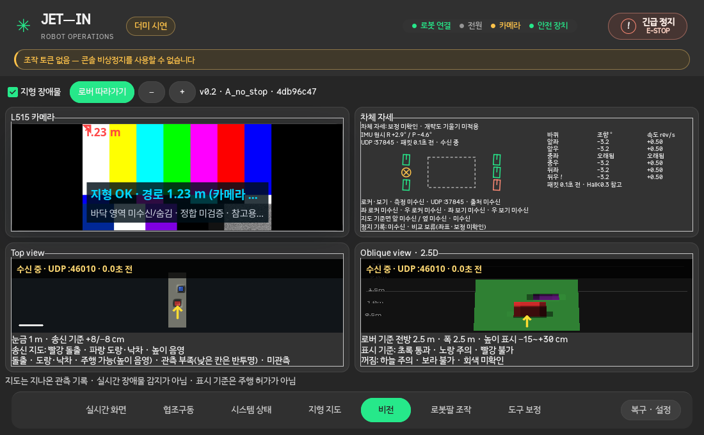
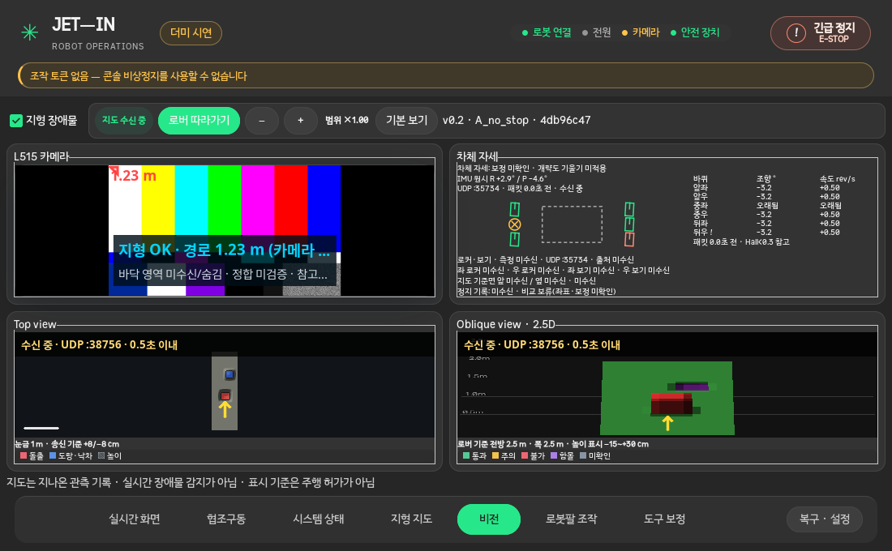

# 비전 GUI 합성 시뮬레이션 최적화 재검증 — 2026-10-25

## 결론

기존의 최신-frame 영상 queue, 지도 worker 분리·2 Hz 제한, 비표시 중 렌더 중지,
`OPENBLAS_NUM_THREADS=1`, 글자 캐시를 유지한다. 최종 후속 검토에서는 지도 상태를
100 ms마다 확인하면서 내용 변화가 없어도 Top/Oblique 캔버스를 다시 그리던 경로를
찾아 change-driven repaint로 바꿨다. 수신·stale 전환 확인 주기는 그대로 유지한다.

최종 코드 `eeb97b6`을 로컬 합성 입력·AC 연결·X11에서 600.001초 연속 실행해
영상·지도·GTK 응답성과 종료 직전 RSS 평탄화를 확인했다. 이전 600.006초 실행은
232.532초에 전원이 분리되고 Wayland를 상속했으므로 참고 자료로만 유지한다.
어느 합성 실행도 Gateway/L515 실기 인수로 처리하지 않는다.

측정 중 발견한 backend 혼입을 막기 위해 성능 하니스에 `--x11` 옵션을 추가했다.
이 옵션은 GTK import 전에 Wayland 환경을 제거하고, 결과 backend가
`GdkX11Display`가 아니면 실패한다. 5초×3구간 실제 Xvfb 실행으로 동작을 확인했다.

## 최종 지도 화면·repaint 개선

- 같은 raster 객체나 같은 상태 문구는 `queue_draw()`를 다시 요청하지 않는다.
- LIVE 문구는 `0.5초 이내`로 안정화하고, 끊긴 뒤 경과 시간만 0.5초 단위로 갱신한다.
  따라서 100 ms 상태 확인은 유지하면서 정상 수신 중 양쪽 지도를 10 Hz로 불필요하게
  다시 칠하지 않는다.
- 지도 상태를 `대기/수신 중/갱신 지연/처리 오류` 배지로 분리했다.
- 확대 배율 표시와 `기본 보기` 복구 버튼을 추가했다. 기본 보기는 배율 1.00과
  로버 따라가기를 함께 복구한다.
- 2~3줄 범례를 한 줄 색상 칩으로 줄이고 상세 설명은 tooltip에 남겼다.
- 창 종료 전에 남은 운용 기록 자동 스크롤 idle callback을 합치고 취소해 GTK 종료
  경고와 파괴된 위젯 접근을 없앴다.

AC 연결·`GdkX11Display`·같은 합성 입력에서 각 구간 15초로 전후를 측정했다.
송신/인코더는 별도 프로세스이며 CPU/RSS는 콘솔 프로세스만 센다.

| 비전 구간 | 개선 전 | 개선 후 |
|---|---:|---:|
| L515 sink | 14.999 FPS | 14.998 FPS |
| Top/Oblique pair | 2.000 Hz | 1.999 Hz |
| 콘솔 CPU | 87.13% | 79.16% |
| RSS 최대 | 333.9 MiB | 327.6 MiB |
| 최대 video draw 간격 | 107.6 ms | 119.2 ms |
| 최대 sink 간격 | 136.5 ms | 139.9 ms |
| 최대 GTK heartbeat 간격 | 41.9 ms | 46.1 ms |
| 지도 worker | 30회 / 평균 12.19 ms | 30회 / 평균 13.09 ms |
| 탭 이탈 뒤 지도 worker | 0회 | 0회 |

CPU는 이번 한 쌍에서 7.98%p 낮게 관측됐지만 짧은 단일 측정이므로 보장된 개선율로
해석하지 않는다. 비전 구간 CPU 클럭 범위는 전 0.399–4.590 GHz, 후
0.399–4.465 GHz였고 최고 온도는 각각 47°C/53°C였다. 입력 FPS·약 2 Hz 지도·
0.5초 미만 응답성과 숨김 중 렌더 중지가 그대로 유지됐다는 회귀 확인이 핵심이다.
실제 Gateway/L515 성능을 대체하지 않는다.

| 개선 전 | 개선 후 |
|---|---|
|  |  |

최종 검증은 비전 관련 단위/회귀 **158 passed**, GTK 창 E2E **7 passed**,
`operator_console.runtime_smoke --vision-only` **PASS**다. E2E에는 같은 상태 문구가
repaint를 유발하지 않는 검사와 확대/이동 뒤 기본 보기 복구 검사가 포함된다.

## 최종 AC/X11 600초 합성 결과

입력은 별도 프로세스의 1280×720@15 SRT 영상 2개, 지도 3 tile,
지형 overlay, 자세·바퀴·로커/보기 더미 텔레메트리다. 송신/인코더 CPU는 제외하며
콘솔 프로세스만 측정한다. `GdkX11Display`, AC 표본 596/596, 최종 revision
`eeb97b6`이었고 `OPENBLAS_NUM_THREADS`의 실제 보고값은 1이었다.

| 항목 | 결과 |
|---|---:|
| 비전 구간 | 600.001초 |
| L515 / D435 sink | 15.000 / 15.000 FPS |
| L515 최대 sink 간격 | 146.3 ms |
| L515 최대 화면 draw 간격 | 120.9 ms |
| GTK heartbeat 최대 간격 | 76.9 ms |
| 0.5초 이상 화면 stall event | 0 |
| Top / Oblique | 각각 1.9976 Hz, 1,204 raster |
| 지도 pair 반영률 | 1.9983 Hz |
| 지도 worker | 1,199회, 평균 11.26 ms, 오류 없음 |
| 비전 탭 이탈 뒤 지도 worker | 0회 |
| 복귀 후 L515 / D435 | 14.993 / 15.017 FPS |
| 콘솔 CPU | 65.15% (논리 코어 하나=100%) |
| callback / worker 오류 | 0 / 0 |

지도는 목표가 약 2 Hz이므로 개별 반영 최대 간격은 606.8 ms였다. 0.5초 화면 정지 판정은
15 FPS 카메라 draw와 GTK heartbeat에 적용하며 둘 다 충분히 통과했다.

RSS는 비전 첫 표본 327.0 MiB, 마지막/최대 341.3 MiB였다. 첫 60초 평균 329.1 MiB에서
마지막 60초 평균 341.3 MiB로 증가했지만, 마지막 60초 범위는 32 KiB로 평탄했다.
일반 `gc.collect()` 뒤 342.1 MiB로 변하지 않았고 개발용 `malloc_trim(0)` 뒤
305.7 MiB로 감소해 native allocator 보유분이 컸다. 제품에 강제 GC나 trim은 추가하지 않았다.

관측 클럭은 0.375–4.800 GHz, 최고 `x86_pkg_temp`는 95°C였다. 90°C 이상 61개 표본에서도
가장 빠른 core는 4.209–4.800 GHz였고 카메라/GTK 정지는 없어서 전 core가 동시에 낮아지는
클럭 붕괴와 프로그램 처리 정지는 관측하지 않았다. 다만 이 최종 실행은 thermal throttle
counter를 별도 저장하지 않았으므로 발열 제한이 전혀 없었다고 단정하지 않는다.

이전에 저장한 혼합 전원·Wayland 600.006초 실행은 L515 15.000 FPS, 지도 각각 1.997 Hz,
최대 draw 134.4 ms, GTK 85.1 ms, stall 0이었다. 전원과 backend가 달라 최적화 전후
CPU 비교에는 사용하지 않는다.

## 짧은 확인과 측정 도구 보강

- 전원 분리 전 20초 비전 구간: L515 14.942 FPS, 지도 1.999 Hz,
  draw 최대 116 ms, GTK 최대 51 ms, 지도 생성 평균 10.43 ms.
- `--x11` 보강 뒤 배터리 Xvfb 5초 비전 구간:
  `GdkX11Display`, L515 14.997 FPS, 지도 2.000 Hz, draw 최대 101 ms,
  GTK 최대 40 ms, 탭 이탈 뒤 지도 worker 0회.
- backend 설정 단위 검사 포함 `test_video_performance.py`: 6 passed.

재실행 명령은 다음과 같다. 결과 경로는 반드시 새 파일이어야 한다.

```bash
OPENBLAS_NUM_THREADS=8 xvfb-run -a /usr/bin/python3 \
  -m operator_console.tests.vision_benchmark \
  --x11 --require-ac --seconds 5 --vision-seconds 600 \
  --allocator-probe --output /tmp/vision-ac-x11-600.json \
  --metrics-output /tmp/vision-ac-x11-600-events.json
```

## 판정 경계

- 합성 입력에서 처리율, 0.5초 카메라/GTK 정지 없음, 지도 약 2 Hz,
  비표시 중 렌더 중지와 AC/X11 600초 지속 실행은 확인했다.
- 15초 전후 CPU 비교와 600초 최종 안정성 측정은 목적이 다르며 서로 개선율 계산에
  섞지 않는다. 600초 CPU 65.15%는 최종 코드의 장기 관측값이다.
- 마지막 60초 RSS는 평탄했지만 전체 구간은 +14.3 MiB였으므로 실제 운용의 장기
  메모리 무증가를 보장하지 않는다.
- 실제 Gateway/L515의 FPS·광학 지연·좌표 정합·발열과 중복 연결 없음은 여전히 HW 미검증이다.

[원시 결과](2026-10-25-vision-simulation-optimization-evidence/)에는 전원 분리 전 짧은 실행,
혼합 전원 600초, 최종 AC/X11 600초 JSON/JSONL, X11 하니스 확인 결과와 event probe를
구분해 보관한다.
